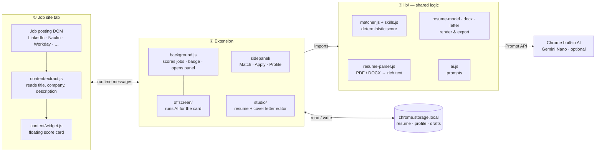
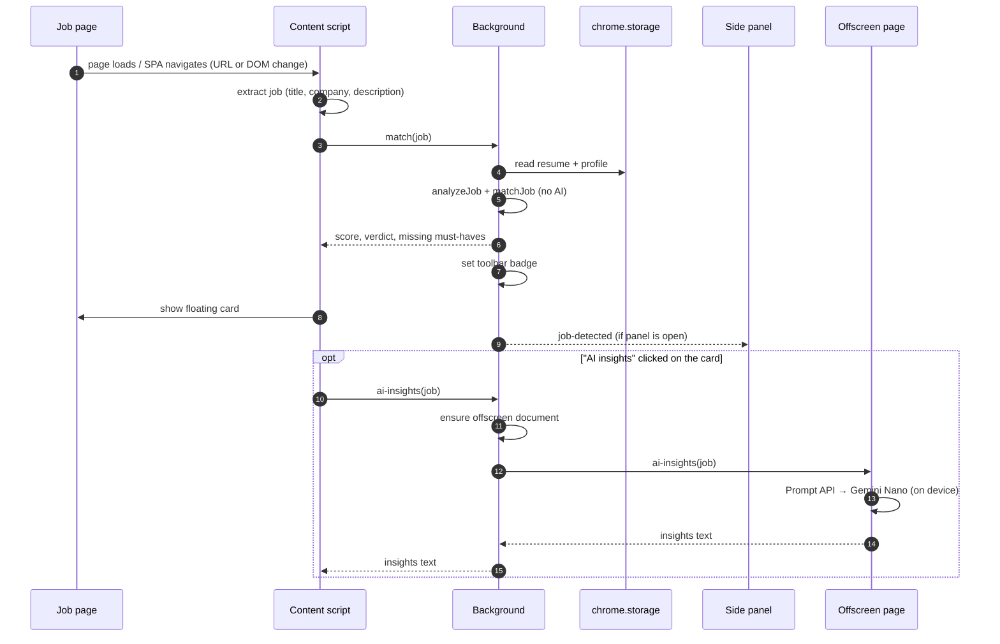
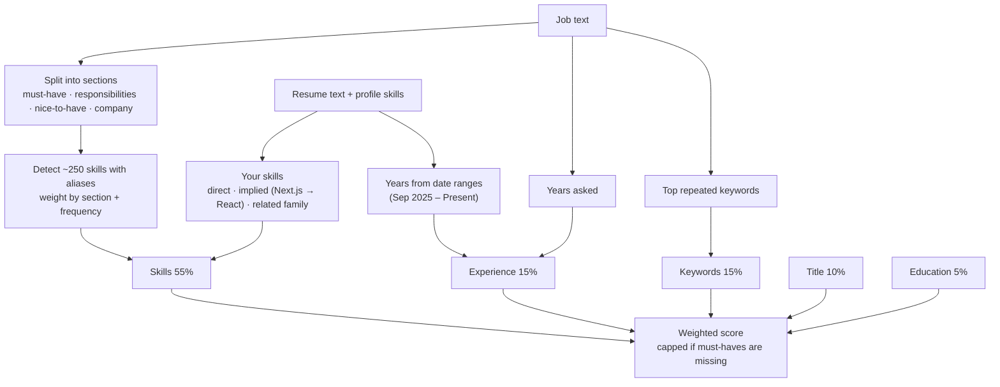
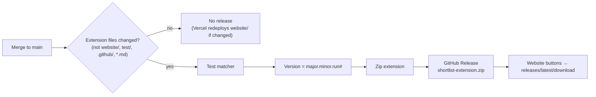

# Shortlist — Local Job Match & Resume Tailor (Chrome extension)

Free, private job-application helper. No sign-in, no API keys, no servers. Everything runs in your browser.

## Install (2 minutes)
1. Download **[shortlist-extension.zip](https://github.com/imRahul05/shortliistt/releases/latest/download/shortlist-extension.zip)** (latest release) and unzip it.
2. Open `chrome://extensions`, turn on **Developer mode** (top right).
3. Click **Load unpacked** and select the unzipped `shortlist` folder.
4. Pin Shortlist and click the icon (or press **Alt+J**). The side panel opens.
5. **Profile** tab: drop your resume (PDF / DOCX / TXT). Check the auto-filled profile fields.

## What it does
| Feature | How | AI needed? |
|---|---|---|
| Read the job | From the page's HTML (the DOM): schema.org `JobPosting` data first, then site-specific selectors (LinkedIn, Indeed, Greenhouse, Lever, Workday, Naukri, Glassdoor, Ashby, Dice, …), then a text-density heuristic. Text you select on the page overrides all of these. | No |
| Match score | About 250 skills with aliases. Detects **must-have / important / nice-to-have** from the job's sections. Adds years of experience (from your resume's date ranges), degree, title and ATS keyword coverage. Each missing must-have caps the score. | No |
| Suggestions | Missing and related skills, experience gaps, keywords, unquantified bullets, weak verbs, missing sections and contact info. | No |
| Floating score card | Appears on any detected job page — LinkedIn, Indeed, Naukri, Greenhouse/Lever/Workday/Ashby/Workable/iCIMS/Taleo/SuccessFactors and more, any page with a job-description block, and jobs embedded in iframes with the match %, must-haves, missing skills and an **AI insights** button that answers right in the card. Minimise to a pill, hide per page, or choose the corner in Settings. **Full report** opens the side panel. | No |
| Toolbar badge | Shows the match % on job pages automatically. | No |
| Resume Studio | Keeps your original formatting: bold/italic, **hyperlinks**, right-aligned dates and links, and a **LaTeX** style (bundled Computer Modern) for LaTeX resumes. **Fit to 1 page** or allow 2 pages (it asks when needed), Letter/A4, page-break guides. Live score, one-click tailoring. Export PDF, DOCX (with links) or TXT. | No |
| Cover letter | Drafted automatically for every job from your profile, best-matching experience and a relevant project; **Generate with AI** for a fully written version. Same header as your resume; export PDF/DOCX. | Optional |
| Autofill | Fills name, email, phone, LinkedIn/GitHub, location, title, years, notice period and salary, and attaches your resume file. Works in iframes too (e.g. Greenhouse embeds). | No |
| Resume auto-detection | Experience timeline from date ranges (`Sep 2025 – Present`, `2025-09`, `Sep '25`, `Since …`), skills, title, company, location — editable in Profile. | No |
| AI layer | Chrome's **built-in Gemini Nano**: fills gaps in resume parsing (extra skills, years when no dates), gives a second-opinion read of job requirements, review, summary, bullet rewrites, cover letter, application answers. Never changes the deterministic score. | Optional |

### About the on-device AI
* Uses `LanguageModel` (Chrome's Prompt API, available to extensions since Chrome 138). It is free and local, with no key.
* Needs desktop Chrome on Windows / macOS / Linux / ChromeOS, about 22 GB free disk, and a GPU with more than 4 GB VRAM or 16 GB RAM. Click **“Enable on-device AI”** in the panel header once to download the model.
* If it isn't available, Shortlist falls back to rule-based tools and templates. Matching never uses AI, so scores are deterministic and explainable.
* Prompts tell the model never to invent employers, dates, metrics or skills. AI bullet rewrites are shown as a diff you accept or reject line by line.

## Privacy
Your resume, profile, history and tailored resumes are stored in `chrome.storage.local` on your machine. **Profile → Delete all my data** wipes them. The extension makes no network requests.

## Architecture

Everything runs inside the browser. There is no backend: the only network traffic is the job page itself and, optionally, Chrome's one-time download of its built-in model.



### What happens when you open a job



### Scoring (deterministic)



### Release pipeline



## Project layout
```
manifest.json            MV3 manifest (side panel, scripting, storage, offscreen)
background.js            scores detected jobs, toolbar badge, opens side panel, routes AI to offscreen
content/extract.js       DOM → job {title, company, description}
content/widget.js        floating score card on job pages (runs in all frames)
offscreen/               hidden page that runs Chrome's built-in AI for the card
lib/skills.js            skill taxonomy, aliases, families, implications
lib/matcher.js           deterministic scoring, date parsing, suggestions
lib/resume-parser.js     PDF (pdf.js) / DOCX → rich text with bold, italic and links
lib/resume-model.js      rich text ↔ editable model, HTML render, tailoring helpers
lib/docx.js              dependency-free DOCX writer (hyperlinks included)
lib/letter.js            cover letter drafting from resume + job
lib/ai.js                optional Chrome built-in AI (Gemini Nano)
lib/autofill.js          form autofill (injected into all frames)
lib/fonts/               Geist, Geist Mono, CMU Serif (OFL)
lib/pdfjs/               Mozilla pdf.js 4.10 (Apache-2.0), bundled locally
sidepanel/               Match · Apply · Profile UI
studio/                  Resume Studio + cover letter
website/                 landing page (Next.js), deployed on Vercel
test/                    `node test/run.mjs` — matcher smoke test
.github/workflows/       release.yml — versioned zip + GitHub Release
```

## Releases
Every push to `main` that changes extension files (anything outside `website/`, `test/`, `.github/` and `*.md`) runs `.github/workflows/release.yml`: it tests the matcher, sets the version to `<major>.<minor>.<build number>` (from `manifest.json`), zips the extension and publishes a GitHub Release. The link above always points to the newest one. Bump `major.minor` in `manifest.json` for bigger releases.

## Website
The landing page lives in `website/` (Next.js + Tailwind + Geist). Deploy on Vercel: **New Project → import this repo → set Root Directory to `website`** → Deploy. Local dev: `cd website && npm install && npm run dev`.

## Tips
* Wrong or empty job text? Select the description on the page and click **Analyze**, or use **Edit job text**.
* Click a red (missing) skill in the Match tab if you really have it. It's added to your profile skills and the score updates.
* Set **Years of experience** in Profile if the value computed from your resume dates is off.
