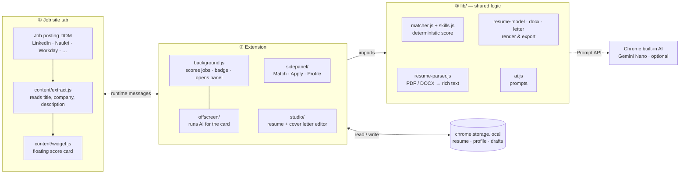

# Architecture

How the pieces fit together: content scripts on the job page, the extension (background, side panel, Studio, offscreen page), the shared `lib/` code, storage and the optional on-device AI.

Everything runs inside the browser. There is no backend: the only network traffic is the job page itself and, optionally, Chrome's one-time download of its built-in model.

[← All diagrams](README.md) · [← Project README](../../README.md)
