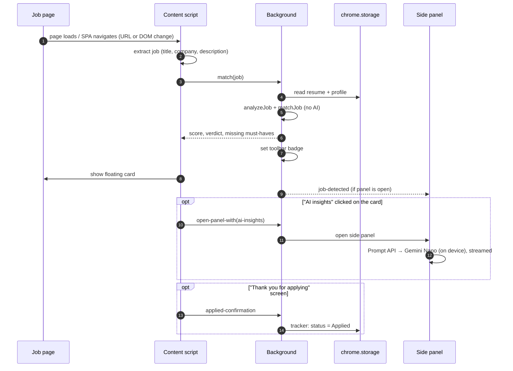

# What happens when you open a job

From reading the job on the page to the floating score card, including the AI insights path (run in the side panel) and automatic application tracking.

[← All diagrams](README.md) · [← Project README](../../README.md)
